Отчёт здоровый. В нём очень много скринов. Ниже оглавление для удобства.

- [1. Запуск своего сервиса напрямую](#1-запуск-своего-сервиса-напрямую)
- [2. Namespaces](#2-namespaces)
  - [2.1. Создание изолированного процесса](#21-создание-изолированного-процесса)
  - [2.2. PID, user и mnt (косвенно)](#22-pid-user-и-mnt-косвенно)
  - [2.3. UTS и net](#23-uts-и-net)
  - [2.4. Сервис внутри namespace](#24-сервис-внутри-namespace)
  - [2.5. IPC и mnt (полностью)](#25-ipc-и-mnt-полностью)
- [3. Cgroups](#3-cgroups)
  - [3.1. Подготовка](#31-подготовка)
  - [3.2. Лимит памяти](#32-лимит-памяти)
  - [3.3. Лимит CPU](#33-лимит-cpu)
  - [3.4. Лимит дочерних процессов](#34-лимит-дочерних-процессов)
  - [3.5. Итог](#35-итог)
- [4. Privileges](#4-privileges)
  - [4.1. Capabilities](#41-capabilities)
  - [4.2. Seccomp](#42-seccomp)
- [5. Mydocker vs docker run](#5-mydocker-vs-docker-run)
  - [5.1. Mydocker.sh](#51-mydockersh)
  - [5.2. Docker run](#52-docker-run)
  - [5.3. Сравнение](#53-сравнение)
- [6. image](#6-image)
  - [6.1. Multi-stage](#61-multi-stage)
  - [6.2. Volumes](#62-volumes)
- [7. Когда контейнера недостаточно](#7-когда-контейнера-недостаточно)
- [8. Мониторинг](#8-мониторинг)

# 1. Запуск своего сервиса напрямую.

В качестве подопытного используется небольшой HTTP-сервис на Go (код сгенерирован с помощью Claude). Он собирается командой `go build -o api .` и запускается через `./api`. Сервис слушает порт 8080 и отвечает как в браузере, так и на `curl`:

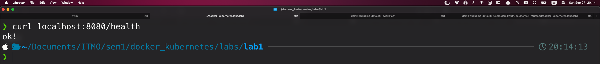

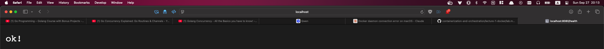

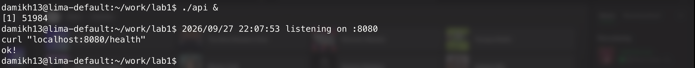

> Сначала сервис был запущен нативно на macOS, затем — в лёгкой консольной виртуалке Lima (Linux), где и выполнялись все дальнейшие эксперименты.

Эндпоинты:

- `/health` — проверка работоспособности (отвечает `ok!`);
- `/eat?mb=N` — выделяет N МБ памяти (для проверки лимита памяти);
- `/burn` — нагружает процессор (для проверки лимита CPU);
- `/settime` — пытается изменить системное время (для проверки привилегий).

Найдём PID процесса на хосте командой `ps aux | grep [a]pi`:

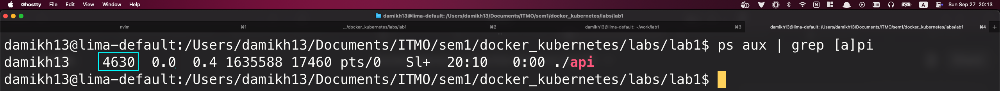

Можем посмотреть, какие у него есть namespace’ы (их мы будем менять в ч.2) при помощи `ls /proc/4630/ns/`:

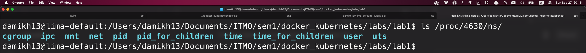

# 2. Namespaces

## 2.1. Создание изолированного процесса

Для начала запустим команду `sudo sysctl -w kernel.unprivileged_userns_clone=1`, чтобы запускать `unshare` без приставки `sudo`. Так будет нагляднее: внутри пользователь будет отображаться как root, а снаружи — как damikh13 (иначе в обоих случаях будет root).

Запустим изолированный bash: `unshare --pid --mount --net --uts --ipc --user --map-root-user --fork bash`. Команда ничего не выводит в консоль.

> Важно не забыть указать флаг --fork, чтобы bash имел в новом namespaces.PID айдишник = 1 (произойдёт создание дочернего процесса в новой таблице процессов, и в нём запустится bash).

## 2.2. **PID, user и mnt (косвенно)**

Проверим PID командой `ps aux` (`a` — процессы всех пользователей, `u` — указывать имя пользователя, `x` — показать и процессы без управляющего терминала, т.е. фоновые службы и демоны).

Однако, если её запустить сразу, то покажется обычный список процессов хоста, несмотря на запущенный ранее `unshare`.

1. Мы отвязали mount, то есть у нашего процесса появилась своя копия mount-таблицы.
2. Но в ней всё ещё присутствует запись: `/proc — (procfs)`.
3. Команда `ps` читает то, что написано в `/proc`.

Выходит, если запустить `ps`, то она покажет все запущенные на системе процессы. Поэтому нужно локально перепривязать значение `/proc` к текущей таблице процессов: `mount -t proc proc /proc`.

Запустим теперь `whoami` (имя пользователя), `echo $$` (номер текущего процесса) и `ps aux` (список видимых нами процессов):


Выходит, точно изолировали для процесса: user, mnt, pid.

## 2.3. **UTS и net**

Проверим изоляцию uts, изменив имя машины при помощи `hostname` и посмотрев, что имя хоста нашего “контейнера” не изменилось:

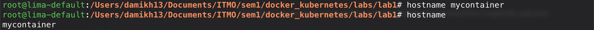

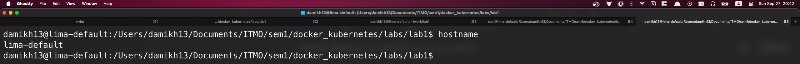

Теперь посмотрим на net. Внутри `ip addr show` показывает единственный интерфейс — выключенный `lo`, тогда как на хосте их несколько (`lo`, `eth0`, `docker0`) и они включены. Чтобы обращаться к `localhost` внутри, поднимем loopback: `ip link set lo up`.

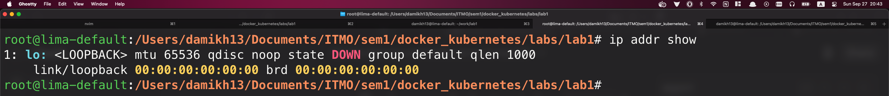

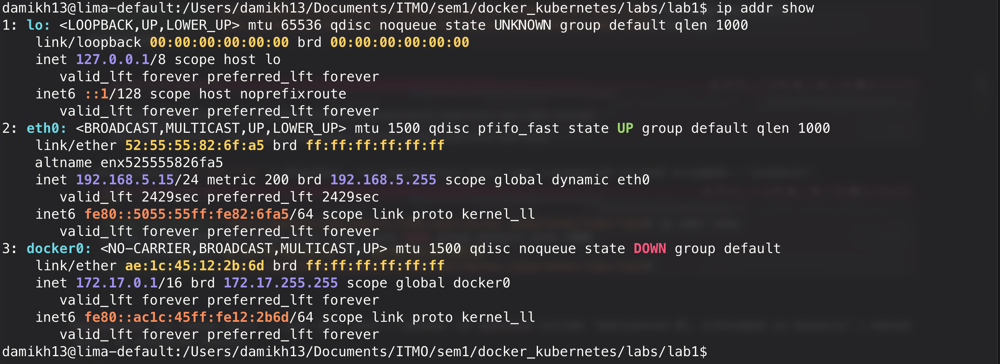


## 2.4. **Сервис внутри namespace**

Запустим `./api` внутри и сравним выводы `ps aux | grep [a]pi`:

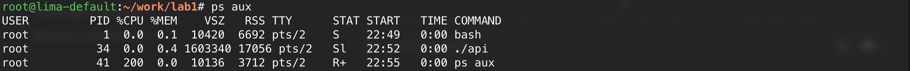

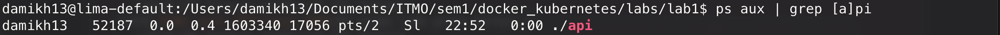

Как можно заметить, изнутри процесс api имеет PID = 34 и запущен пользователем root, а снаружи — 52187 и damikh13.

## 2.5. **IPC и mnt (полностью)**

Запустим внутри ограниченного процесса несколько очередей сообщений — глобальных системных объектов (IPC):


… и убедимся, что они недоступны из-под хоста:


Наконец, докажем изоляцию mnt (а то в /procs оно упомяналось лишь косвенно). Примонтируем внутри временную файловую систему и создадим в ней файл. Увидим, что он есть локально, но отсутствует глобально (⇒ изменения mount-таблицы из процесса не утекли в хост)

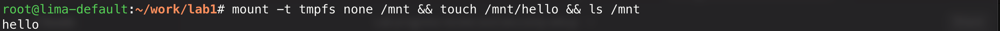

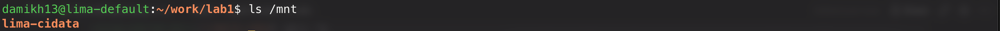

Эмпирическим путём подтвердили изоляцию pid, mnt, net, uts, ipc и user!

# 3. Cgroups

## 3.1. **Подготовка**

Убедимся, что существует виртуальная файловая система для управления ограничениями — cgroup2, при помощи `mount | grep cgroup2`, и посмотрим на доступные нам контроллеры:

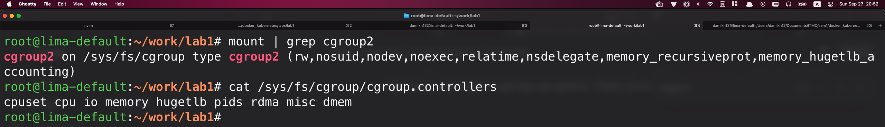

Для изменения системного каталога нужны права, поэтому сначала выходим из изолированной оболочки (`exit`), а затем создаём группу:

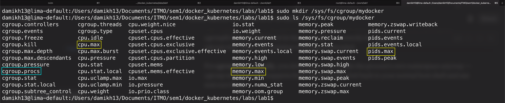

Файлик `cgroup.procs` на скриншоте выше содержит ID процессов, для которых будут применены ограничения, описанные в других файлах (cpu.max, memory.max, pids.max и т.д.).

Запустим наш сервис, посмотрим на его PID — 5382:

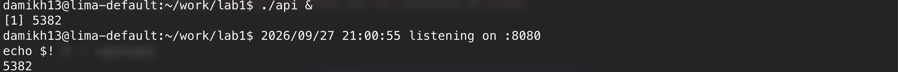

Запишем этот айдишник в cgroup.procs:

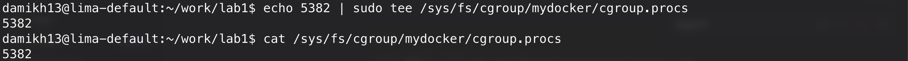

## 3.2. Лимит памяти

Добавим ему ограничение памяти:

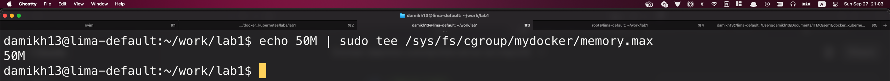

И проверим, что если процесс пробует скушать 200 МБ, то ему это не удастся:

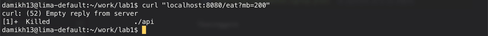

Если посмотреть системные логи, то в конце увидим убийство процесса через oom-kill:

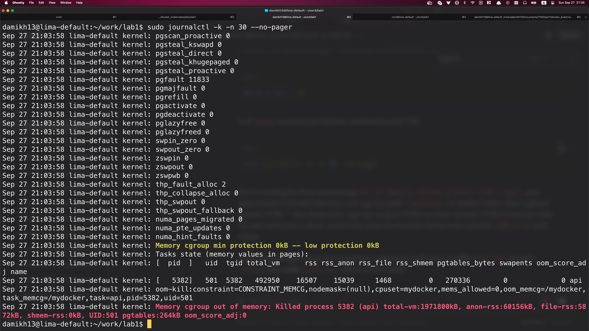

## 3.3. Лимит CPU

Проверим теперь ограничение использования процессора. Для начала добавим его (”можешь использовать 50 000 микросекунд (50 мс) каждые 100 000 микросекунд”, т.е. процесс может занимать не больше 50% процессорного времени):

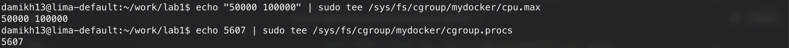

Затронем эндпоинт /burn и оставим его работать на несколько секунд, после чего посмотрим на статистику `cpu.stat`:

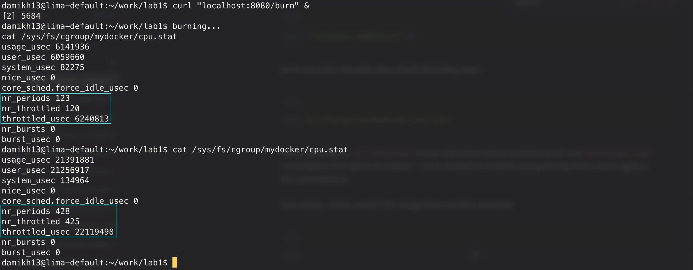

Как можно заметить, из 428 окон по 100 мс, наш процесс почти в каждом из них 425 тратил свои отведённые 50 мс, а затем начинал троттлить.

Также можно посмотреть на процессор задач, процесс использования CPU у нашего процесса (эмулирующей машины Linux’а) в котором достигает 50%:

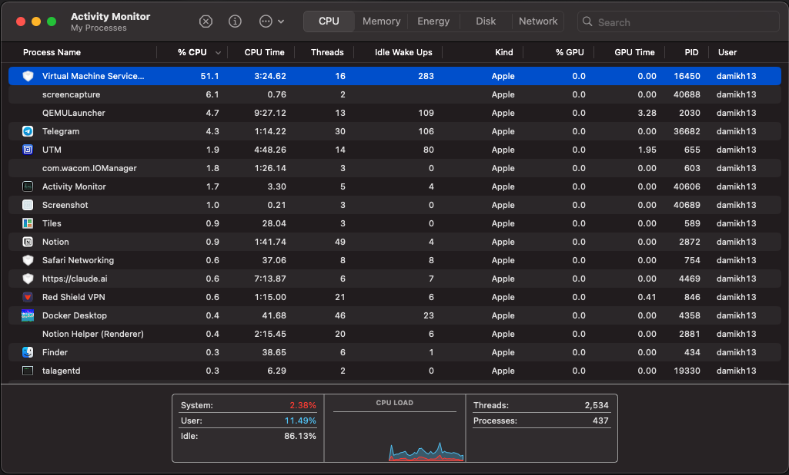

## 3.4. Лимит дочерних процессов

Добавим:

```bash
echo 20 | sudo tee /sys/fs/cgroup/mydocker/pids.max
```

Узнаем PID нашего ограниченного процесса, чтобы выдать ограничение именно ему, а не только сервису API (более приближенно к тому, как работает Docker):

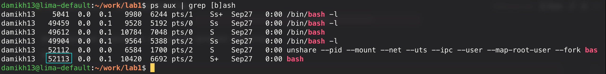

Добавим его в cgroup.procs при помощи `echo 52113 | sudo tee /sys/fs/cgroup/mydocker/cgroup.procs`.

Зайдём во вкладку с процессом и запустим форк-бомбу:


При этом сразу видим, что ограничение достигнуто:

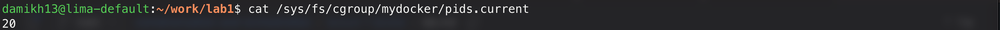

## 3.5. Итог

Все 3 ограничения работают:

- поставили 50M и просим 200 — процесс убивается oom-kill
- поставили 50% CPU — ему столько и отводится
- поставили в максимум дочерних процессов — больше и не создаётся

# 4. P**rivileges**

## 4.1. Capabilities

Посмотрим на список всех доступных root’у (для этого добавим sudo в начало) привелегий:

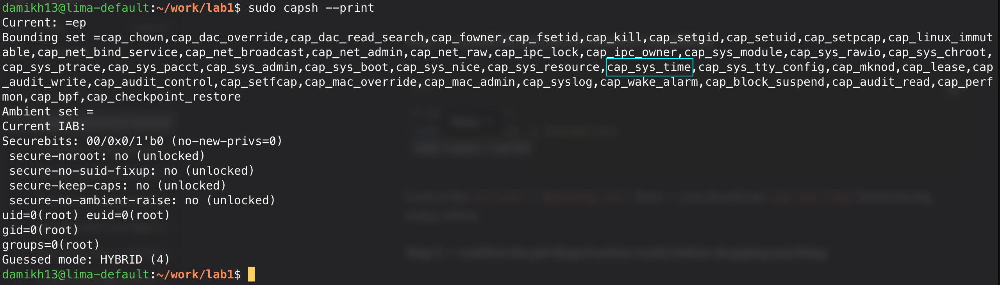

Проверим, что можем ограничивать через `capsh --drop=...`: первый вызов срабатывает, второй — нет:

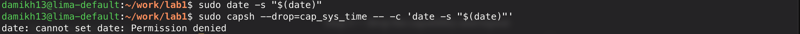

Запустим сервис без ограничений через `sudo ./api` и попробуем изменить время, затронув `curl localhost:8080/settime`:


Успешно: у процесса была привелегия `CAP_SYS_TIME`, поэтому он смог выполнить соотв. системный вызов.

А теперь запустим его с ограничениями:

```bash
sudo capsh --drop=cap_sys_time,cap_sys_module,cap_sys_admin,cap_net_admin,cap_sys_boot,cap_sys_ptrace -- -c './api'
```

Теперь вызов блокируется:

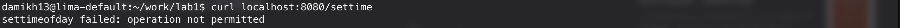

## 4.2. Seccomp

Хотим продемонстрировать, что процесс, у которого есть все права, всё равно не может сделать системный вызов, который был заблокирован seccomp-фильтром.

Так как фильтр может применяться самим процессом на себя, но не может быть присвоен какому-то другому процессу по его ID, то напишем маленький скрипт, который будет разрешать все действия, кроме системного ‘settimeofday’ (того же действия, что выполняется при /settime нашего API). Такая архитектура — сделать обёрточку — также хорошо эмулирует безопасность: скрипт точно сначала применит фильтр, а затем запустит `api`. Если бы фильтр применялся внутри api, то, возможно, нашлась бы уязвимость, которая сработает до инициализации фильтра (хакер успеет выполнить 10 системных вызовов, а только потом исполнение кода дойдёт до “запретить действия X, Y и Z”):

```python
#!/usr/bin/env python3
import errno, os, sys, seccomp

f = seccomp.SyscallFilter(defaction=seccomp.ALLOW)   # denylist: allow everything by default
f.add_rule(seccomp.ERRNO(errno.EPERM), "settimeofday")    # what your Go handler uses
f.load()                                             # installs the filter, sets no_new_privs
os.execvp(sys.argv[1], sys.argv[1:])
```

Запустим сервис через sudo (без фильтров) и убедимся, что /settime работает:

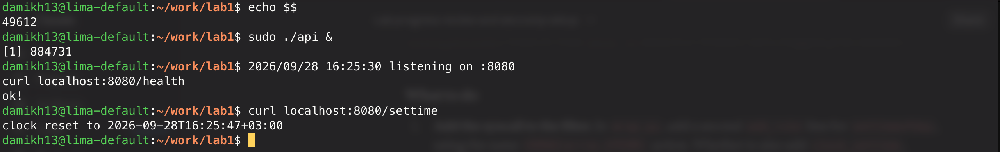

Теперь запустим с обёрточным скриптом, который установит фильтр “можно всё, кроме settimeofday”:


Если найти PID api через `ps aux | grep [a]pi` и подключиться к нему через `strace` перед запуском `curl localhost:8080/health`, то увидим попытку вызова ‘settimeofday’, которая была заблокирована с кодом ошибки “EPERM (Operation not permitted)”:

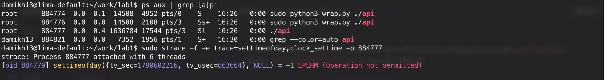

# 5. Mydocker vs docker run

## 5.1. Mydocker.sh

Напишем (нагенерим) скрипт из всех упомянутых выше команд:

```bash
#!/bin/bash
set -euo pipefail                      # stop on first error, on unset variables, on failed pipes

# if script is ran by non-root (id != 0) user
if [ "$(id -u)" -ne 0 ]; then
    echo "run with sudo"
    exit 1
fi

# runing ~/work/lab1/mydocker.sh automatically does cd ~/work/lab1
cd "$(dirname "$0")"

# 1. cgroups
CG=/sys/fs/cgroup/mydocker
mkdir -p "$CG"
echo $$ > "$CG/cgroup.procs"
echo 50M          > "$CG/memory.max"
echo 0            > "$CG/memory.swap.max"   # so swap can't mask the memory limit
echo "50000 100000" > "$CG/cpu.max"
echo 20           > "$CG/pids.max"

cleanup() {
  echo $$ > /sys/fs/cgroup/cgroup.procs        # put current proc into system procs, so it's automatically deleted from mydocker/cgroup.procs
  cat "$CG/memory.events" 2>/dev/null || true  # prints oom_kill count before it's deleted
  echo 1 > "$CG/cgroup.kill" 2>/dev/null || true
  for i in 1 2 3 4 5; do rmdir "$CG" 2>/dev/null && break; sleep 0.2; done
}
trap cleanup EXIT # on exit event, cleanup()

# 2. namespaces (loopback net UP, hostname = mycontainer) -> drop capabilities -> seccomp (with wrap.py) -> run ./api
unshare --pid --mount --net --uts --ipc --fork sh -c '
  mount -t proc proc /proc
  ip link set lo up
  hostname mycontainer
  exec capsh --drop=cap_sys_time,cap_sys_module,cap_sys_admin,cap_net_admin,cap_sys_boot,cap_sys_ptrace,cap_sys_rawio \
       -- -c "exec python3 wrap.py ./api"
'
```

Сделаем его исполняемым (`chmod +x mydocker.sh`). И запустим:

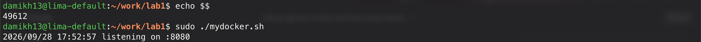

Подключимся к этому процессу в другой вкладке (через `nsenter`) и позапускаем curl’ы:

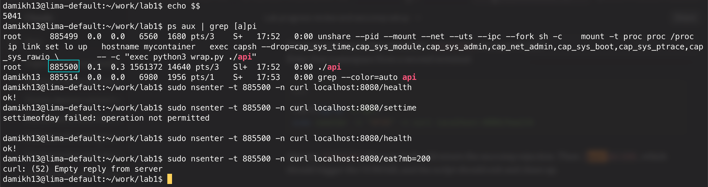

Как видно, ограничения работают:


## 5.2. Docker run

Теперь сделаем то же самое с настоящим docker’ом. Dockerfile:

```docker
FROM scratch
COPY api /api
EXPOSE 8080
ENTRYPOINT ["/api"]
```

Забилдим Docker-образ, указав ему имя ‘mydocker-api’ (docker сам добавит :latest) и директорию `.`, в которой нужно искать Dockerfile и откуда нужно будет делать COPY:

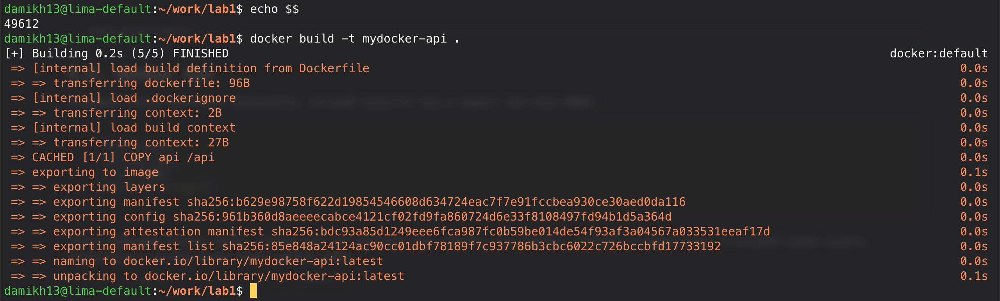

Запустим наш контейнер на основе собранного образа:

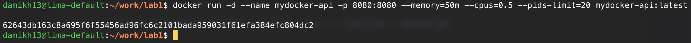

Проверим, что он отзывается, не может устанавливать системное время и убивается при пересечении лимита oom-kill’ом:


Снова поднимем его и запустим последовательно команды:

```bash
PID=$(docker inspect -f '{{.State.Pid}}' mydocker-api)
sudo grep -E 'NSpid|CapEff|Seccomp|NoNewPrivs' /proc/$PID/status
```

Получим:


- PID процесса ./api на хосте — 1307706, внутри контейнера — 1.
- CapEff: a80425fb означает (если посмотреть через capsh --decode=a80425fb) 14 возможностей (capabilities): `chown`, `dac_override`, `fowner`, `fsetid`, `kill`, `setgid`, `setuid`, `setpcap`, `net_bind_service`, `net_raw`, `sys_chroot`, `mknod`, `audit_write`и `setfcap` — нет cap_sys_time, поэтому и settimeofday не срабатывает.
- Seccomd: 2 — значит, выбран 2-й режим (0 — вообще без фильтров, 1 — старый режим с разрешёнными read, write, exit и sigreturn, 2 — режим с применённым фильтром).

Посмотрим те же параметры у mydocker.sh:


## 5.3. Сравнение

1. механизм “внутри процесс будет иметь PID = 1” работает в обоих случаях
2. capabilities: у mydocker.sh они “все - 7 дропнутых”, у docker’а — “14 фиксированных разрешённых”.
3. привелегии: mydocker.sh никак не может вызвать потомка с бОльшими привелегиями, docker — может.
4. seccomp: в обоих случаях режим второй, только у mydocker.sh был deny-list (перечисляли, что нельзя), а у docker — allow-list (дефолтный список того, что можно)
5. cgroup: у mydocker.sh выставлены вручную, у docker — через флаги --memory, --cpus, --pids-limits. По сути, итоговый результат один и тот же.
6. filesystem: у docker.sh её нету, у docker — есть самая минимальная (scratch).
7. сеть: при запуске mydocker.sh до api можно достучаться только через nsenter, а у docker уже настроена сеть с пробросом портов (у меня он работает на виртуалке lima, но запросы доходят и из Safari).

# 6. image

## 6.1. Multi-stage

Перепишем Dockerfile так, чтобы срабатывала multi-stage сборка. В первой стадии будет собираться исполняемый файл. Важно, что собираться он будет без зависимостей от ‘C’, т.к. в следующей стадии C вообще нету.

```docker
FROM golang:1.23 AS build
WORKDIR /src
COPY go.mod ./
COPY *.go ./
RUN CGO_ENABLED=0 go build -o /api .

FROM scratch
COPY --from=build /api /api
EXPOSE 8080
ENTRYPOINT ["/api"]
```

Сделаем build и сравним размеры:


Как можно заметить, размеры практически одинаковые. Это логично: оба контейнера содержат scratch + бинарник.

> На самом деле, можно найти слой, соотв. команде `FROM golang:1.25` через `docker images`:
>
> 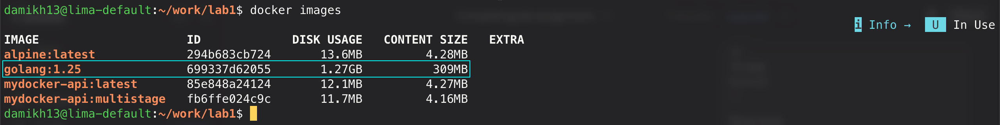

Если изменим файлик main.go (добавим комментарий) и перезапустим сборку, то увидим, что часть слоёв достаётся из кэша (`WORKDIR /src`, `COPY go.mod ./`), а часть — запускается заново (`COPY *.go ./`, `RUN go build`).

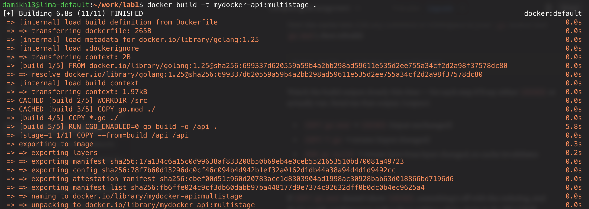

## 6.2. Volumes

Теперь докажем, что инфа в контейнерах стирается, если не использовать общую папку — volume.

Вот мы записали что-то в контейнер voltest:

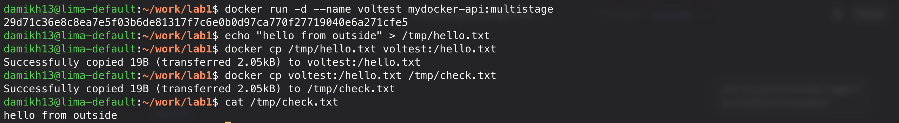

Перезапустили его — файла нет:

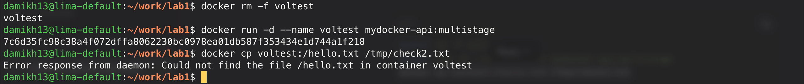

Добавили volume — файл сохраняется:

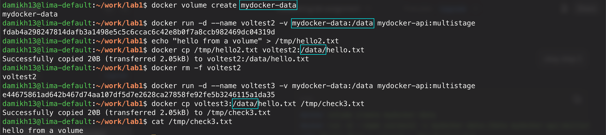

# 7 — когда контейнера недостаточно

Скачаем gVisor:

```bash
curl -fsSL https://gvisor.dev/archive.key | sudo gpg --dearmor -o /usr/share/keyrings/gvisor-archive-keyring.gpg
echo "deb [signed-by=/usr/share/keyrings/gvisor-archive-keyring.gpg] https://storage.googleapis.com/gvisor/releases release main" | sudo tee /etc/apt/sources.list.d/gvisor.list > /dev/null
sudo apt-get update && sudo apt-get install -y runsc
```

Добавим докеру возможность запускать контейнеры через `runsc`:

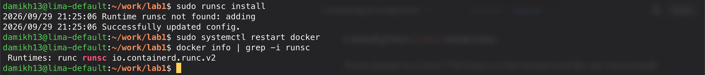

Создадим 2 контейнера: один будет запускаться через дефолтный `runc`, другой — через `runsc`:

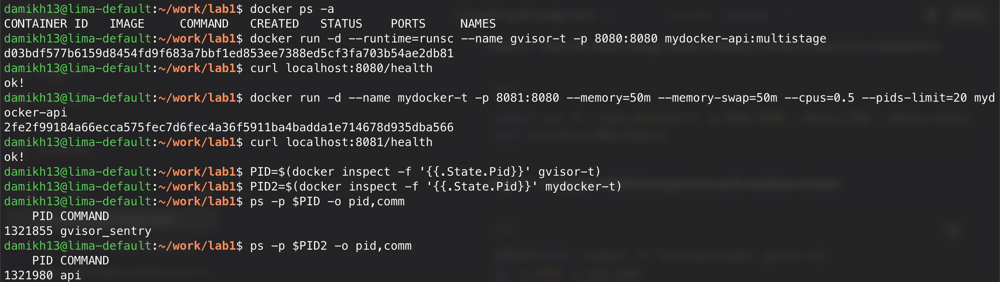

Как видно, `runsc` дал больший уровень изоляции: в общей таблице процессов хоста контейнер gVisor’а показывает лишь ‘gvisor_sentry’, в то время как runc — ‘api’.

Ответы на вопросы: “What does an ordinary container always share with the host? And why is that the limit of container isolation?”.

Обычный контейнер делит с хостом ядро. Мы его ограничили: сказали, что он не может видеть (pid, mount, …). Указали, сколько ресурсов может потреблять, какие системные вызовы может делать. Однако, когда он делает этот системный вызов (read(), write(), nmap(), …), они выполняются ядром хоста. Мы не можем попросить отдельное ядро.

Эту проблему решает gVisor, вводя прослойку между кодом внутри контейнера и ядром.

# 8 — мониторинг

## Объяснение пайплайна

Для метрик возьмём значения из cgroup-файлов (memory.current, cpu.stat, pids.current, memory.events (для отслеживания OOM’ов)).

Так как в исходном скрипте api-шки метрики не прописывались, был придуман костыль — `cgroup_exporter.py`. Для каждого контейнера он собирает метрики (напр., `cgroup_memory_max_bytes{name="lab-api"} 52428800`). Prometheus будет scrape’ить именно его.

(изначально была попытка сделать через cAdvisor вместо экспортера, но 29-й Docker и cAdvisor v0.49.1 lim’ы не могли подружиться).

Далее при помощи docker-compose.yml будут запускаться все сервисы:

- `api`
- `cgroup-exporter`
- `prometheus`
- `grafana`

Алерты были настроены в monitoring/alerts.yml:

- `ContainerMemoryNearLimit` ← память 90%+ от memory.max на протяжении 30 сек
- `ContainerCpuThrottled` ← троттлинг выше 25% на протяжении 1 мин.
- `ContainerRestarted` ← счётчик рестартов докера изменился за последние 5 мин.

## Результаты

Запустим `docker compose up -d --build`.

Откроем Prometheus (http://localhost:9090/targets) — метрики успешно собираются с cgroup-exporter’а:


Откроем Grafan’у (http://localhost:3000/) — графики есть!


Запустим команду, которая заставит сервис превысить лимит памяти (`curl "localhost:8080/eat?mb=200"`). Случился OOM, счётчик рестартов обновился, алерт стал красным:

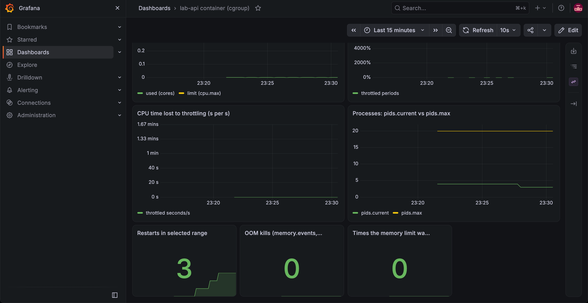

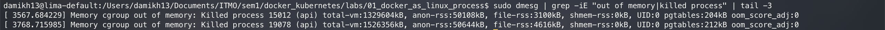

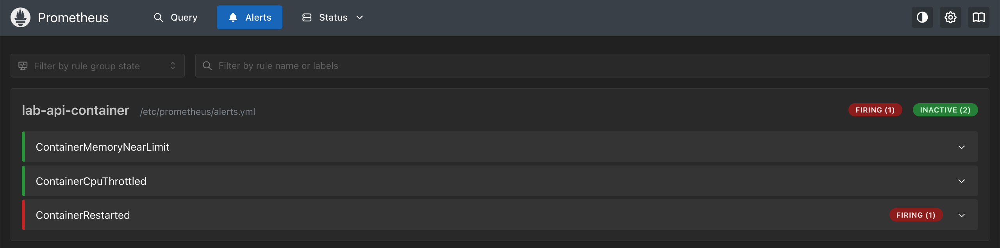

(OOM kills = 0 в Grafa, т.к. контейнер api перезапустился, а значит, в папке cgroup обновился файлик; что OOM, на самом деле, был, видно из 3-го скрина)

Проверим всплески памяти на `curl "localhost:8080/eat?mb=40”`: и всплески CPU на `curl "localhost:8080/burn”`:

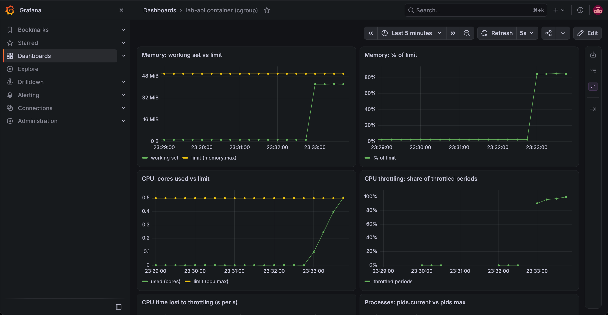

Убедимся также, что алерт сначала имел статус ‘pending’, а спустя минуту — ‘firing’:

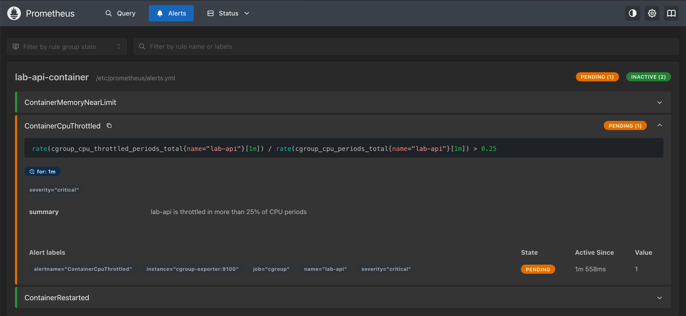

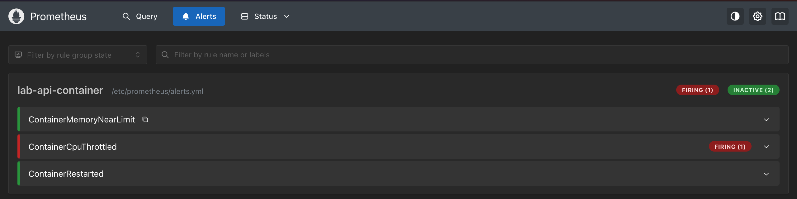
