# Подготовка нужных файлов

## api

Сначала нагенерим api-сервис — main.go со следующими функциями:

- /health → “ok”
- /metrics → текст метрик
- /fail → 500 Internal Server Error + поставить пометку ‘failed’
- /slow → ждать [1,3] сек. перед ответом
- /load → сделать много одновременных запросов (/load?n=500&path=/fail)

---

Метрики (RED):

- Rate: http_requests_total ← сколько всего было запросов
- Errors: http_errors_total ← сколько было ошибок с кодом 5xx
- Duration: http_request_duration_seconds ← сколько времени занимает выполнение запросов

Логи:

- структурированные JSON-объекты, имеют поля trace_id и span_id

Трейсы (OpenTelemetry).

Затем напишем Dockerfile с multi-stage сборкой для запуска нашего api:

```docker
FROM golang:1.27-alpine AS build
WORKDIR /src
COPY go.mod go.sum* ./
COPY main.go ./
RUN go mod tidy && CGO_ENABLED=0 go build -o /out/lab-api .

FROM gcr.io/distroless/static-debian12:nonroot
COPY --from=build /out/lab-api /lab-api
EXPOSE 8080
ENTRYPOINT ["/lab-api"]
```

Разберём файл deploy.sh для поднятия кластера через kind и подкачки нужных чартов всего стека мониторинга (которые будут инструкциями кластеру о том, что скачивать и запускать):

```bash
#!/usr/bin/env bash
set -eo pipefail # stop on any error; commands with '|' fail if any command fails

CLUSTER=lab
IMAGE=lab-api:0.1

# create the kind cluster if it doesn't exist yet
# q = "print nothing, just give the result"
# x = "match the whole line"
kind get clusters | grep -qx "$CLUSTER" || kind create cluster --name "$CLUSTER"

# build api image from Dockerfile
docker build -t "$IMAGE" ./api
# ... and make it available inside the cluster
kind load docker-image "$IMAGE" --name "$CLUSTER"

# add prometheus and grafana to helm (k8s package manager)
# >dev/null to send messages like "Repository added successfully!" to linux folder that'll auto-delete them
helm repo add prometheus-community https://prometheus-community.github.io/helm-charts >/dev/null
helm repo add grafana https://grafana.github.io/helm-charts >/dev/null

# fetch latest charts (collection of yamls) from both repositories
helm repo update >/dev/null

# prometheus, alertmanager, grafana, helpers
helm upgrade --install kps prometheus-community/kube-prometheus-stack -n monitoring --create-namespace -f helm/values/kube-prometheus-stack.yaml --wait --timeout 10m
# loki
helm upgrade --install loki grafana/loki -n monitoring -f helm/values/loki.yaml --wait --timeout 10m
# log collector
helm upgrade --install alloy grafana/alloy -n monitoring -f helm/values/alloy.yaml --wait --timeout 5m
# jaeger
helm upgrade --install extras ./helm/observability-extras -n monitoring --wait

helm upgrade --install lab-api ./helm/lab-api -n lab --create-namespace --wait

echo "done. run ./port-forward.sh to open the UIs."

```

Получается, по его запуску будет примерно такая архитектура:

```bash
PC
└─ Docker Desktop
   └─ container "lab-control-plane" <- наш cluster
      └─ Kubernetes (API server, scheduler, kubelet...)
         └─ containerd
            ├─ container: lab-api
            ├─ container: prometheus
            ├─ container: grafana
            ├─ container: loki, alloy, jaeger, karma ...
            └─ ...
```

Запустим ./deploy.sh и убедимся, что всё работает (просто посмотрим на вывод `kubectl get pods -A`):

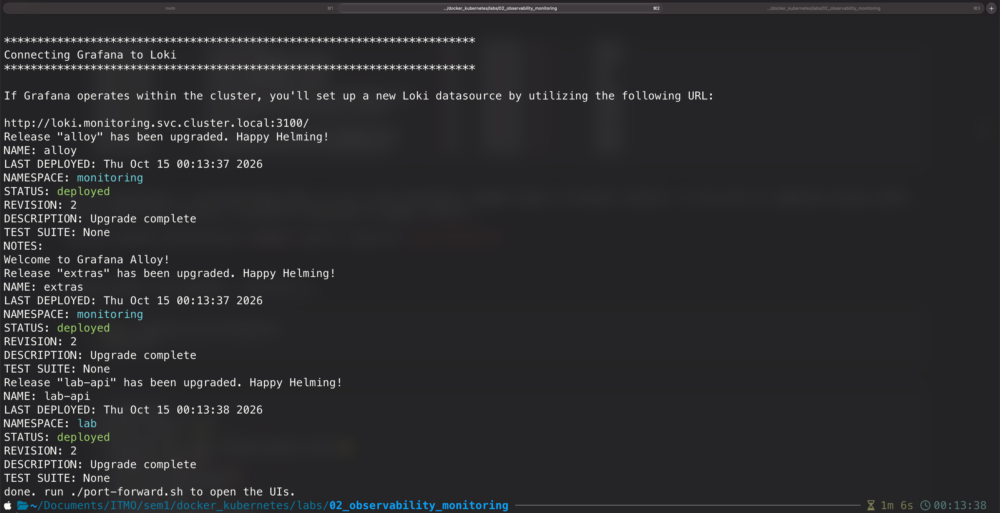

Можем посмотреть поды через `kubectl get pods -A`:

```bash
❯ kubectl get pods -A
NAMESPACE            NAME                                        READY   STATUS    RESTARTS   AGE
kube-system          coredns-559f6c778d-2d24w                    1/1     Running   0          5m2s
kube-system          coredns-559f6c778d-mdbxf                    1/1     Running   0          5m2s
kube-system          etcd-lab-control-plane                      1/1     Running   0          5m10s
kube-system          kindnet-lww69                               1/1     Running   0          5m2s
kube-system          kube-apiserver-lab-control-plane            1/1     Running   0          5m9s
kube-system          kube-controller-manager-lab-control-plane   1/1     Running   0          5m9s
kube-system          kube-proxy-29v87                            1/1     Running   0          5m2s
kube-system          kube-scheduler-lab-control-plane            1/1     Running   0          5m9s
lab                  lab-api-68595f44-7cnqq                      1/1     Running   0          57s
local-path-storage   local-path-provisioner-75f7fc7dc5-dwrfz     1/1     Running   0          5m2s
monitoring           alert-webhook-84d8df758d-jtxqs              1/1     Running   0          82s
monitoring           alertmanager-prom-stack-alertmanager-0      2/2     Running   0          4m25s
monitoring           alloy-p9bh5                                 2/2     Running   0          2m21s
monitoring           grafana-7cb669ff79-f6crc                    3/3     Running   0          4m43s
monitoring           jaeger-68df6b557c-7d6qc                     1/1     Running   0          82s
monitoring           karma-7459f479b5-vmdr6                      1/1     Running   0          82s
monitoring           kps-kube-state-metrics-747b7b996-hx9jf      1/1     Running   0          4m43s
monitoring           kps-prometheus-node-exporter-zbhzc          1/1     Running   0          4m43s
monitoring           loki-0                                      2/2     Running   0          3m17s
monitoring           prom-stack-operator-6bc4f65884-87xgx        1/1     Running   0          4m43s
monitoring           prometheus-prom-stack-prometheus-0          2/2     Running   0          4m25s
```

Так как изначально у кластеров была идея, что не стоит выставлять каждый сервис в интернет напоказ, то они пока что работают внутри своей сети и недоступны локально (localhost в браузере не выдаст ничего).

Поэтому сделаем дополнительно проброс портов, запустив `./port-forward.sh` (несколько команд `kubectl -n monitoring port-forward svc/grafana 3000:80` — “слушай соединение на моём порту 3000 и перенаправляй всё внутрь кластера — в сервис grafana):

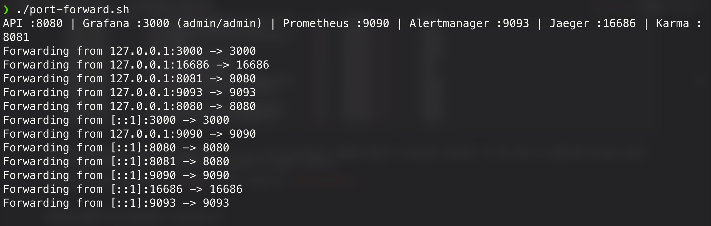

- API: `:8080`
- Grafana: `:3000` (login `admin` / `admin`)
- Prometheus: `:9090`
- Alertmanager: `:9093`
- Jaeger: `:16686`
- Karma: `:8081`

Теперь можем проверить работу сервиса через curl’ы (`localhost:8080/health`, `-i localhost:8080/fail`, `localhost:8080/slow`, `"localhost:8080/load?n=300"`, `localhost:8080/metrics | grep http_requests_total`)

!Screenshot 2026-10-15 at 00.29.12.png

API’шка работает, перейдём к мониторингу.

# Мониторинг

Общая схема выглядит вот так:

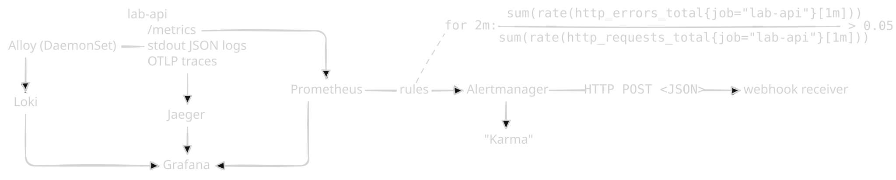

## Prometheus, Grafana, alerts

Откроем панель Prometheus’а (http://localhost:9090/targets):

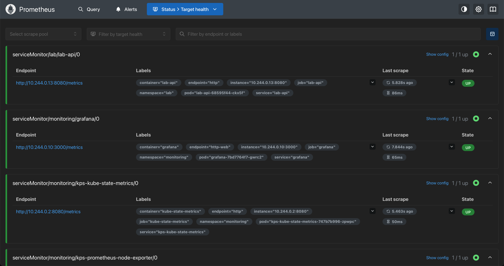

Увидим множество target’ов, с которых serviceMonitor собирает метрики. У них есть:

- endpoint'ы: `http://10.244.0.13:8080/metrics` — приватный адрес пода внутри кластера
- label’ы: теги, которые prometheus дал метрикам (какой namespace, какой pod, какой контейнер)
- last scrape: когда последний раз были собраны метрики
- state: получилось ли обратиться. Если не вышло, то можно сделать какой-то алерт (например, `up{job="lab-api"} == 0` = LabApiDown, увидим позже)

Теперь Grafana (http://localhost:3000/ → Dashboards → lab-api RED). Запустим curl’ы — увидим скачки в графиках:

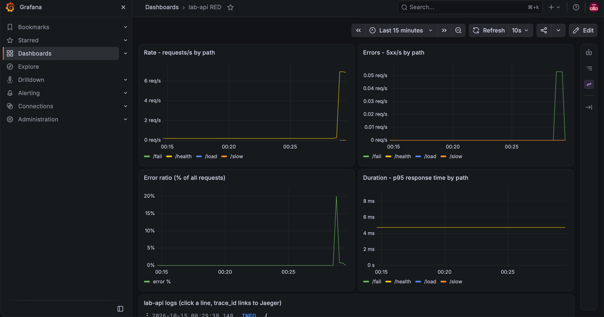

Далее посмотрим логи. Для этого в Grafana перейдём в Explore, там выберем Loki. Укажем ‘Code’, а не ‘Builder’. Вставим следующий запрос: `{namespace="lab"}`.

```
{namespace="lab"}
```

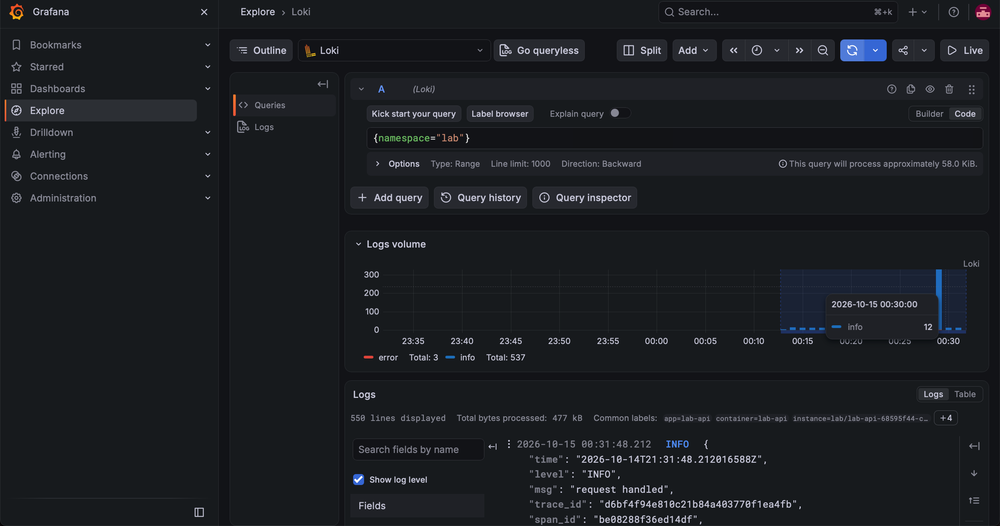

Если изменим запрос на `{namespace="lab"} |= "fail handler”`, то увидим наши симулированные падения сервера:

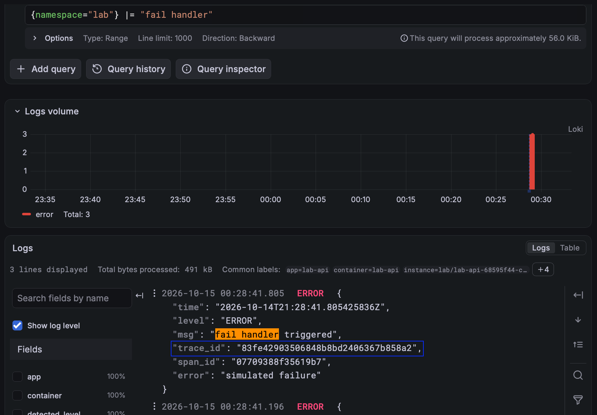

Теперь взглянем на трейсы.

Откроем Jaeger через http://localhost:16686/. Выберем Service = lab-api и Operation = GET/slow.

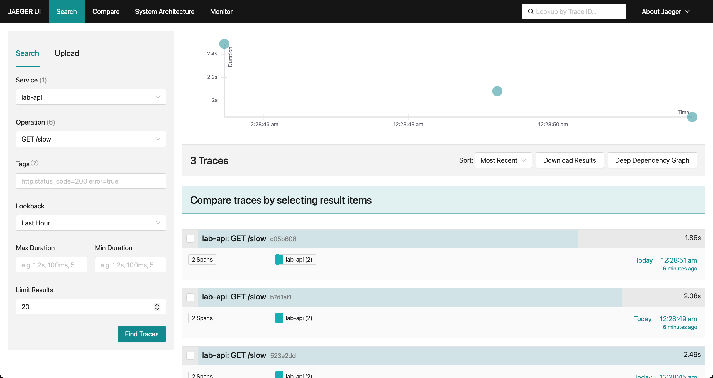

Изменим на GET /fail — увидим ошибки.

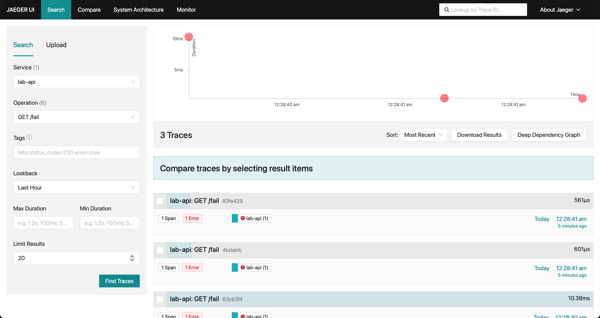

Посмотрим, что есть связь между логами и трейсами. Откроем логи с `{namespace="lab"} |= "fail handler”`. У них есть `trace_id`. Нажмём на него — открывается split-панелька:

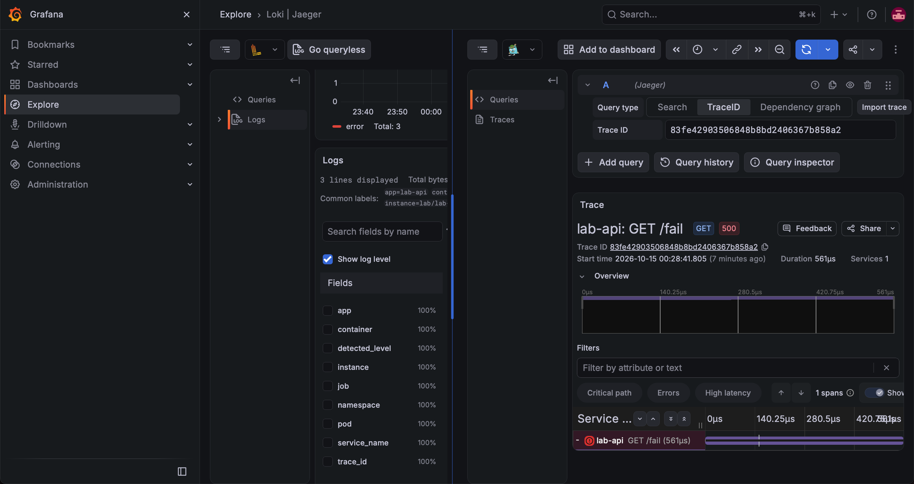

Для более удобного вида можем скопировать trace_id и вставить его в Jaeger:

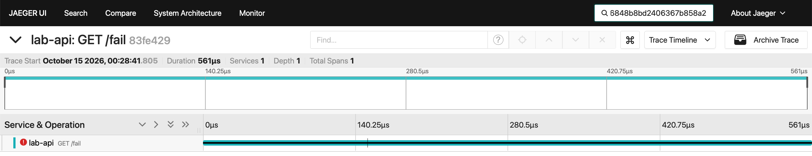

Наконец, посмотрим, как работают алерты.

Запустим на ~2 минуты команду, генерирующую много запросов к `api/fail`:

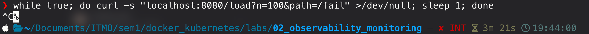

Увидим, что в обеих системах появился алерт `LabApiHighErrorRate` (процент ошибок response’ов > 5 за последние 2 минуты):

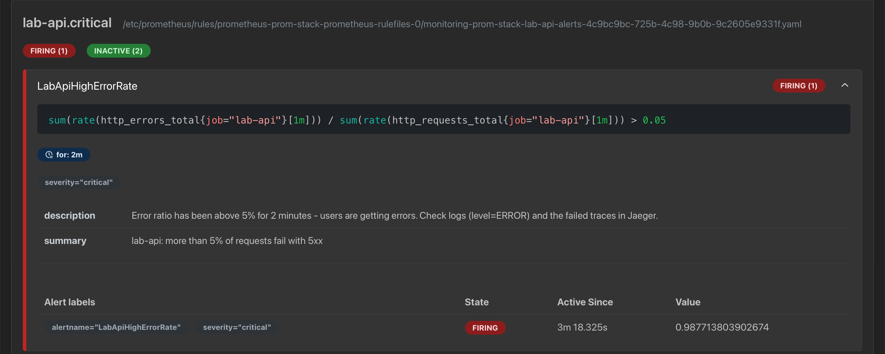

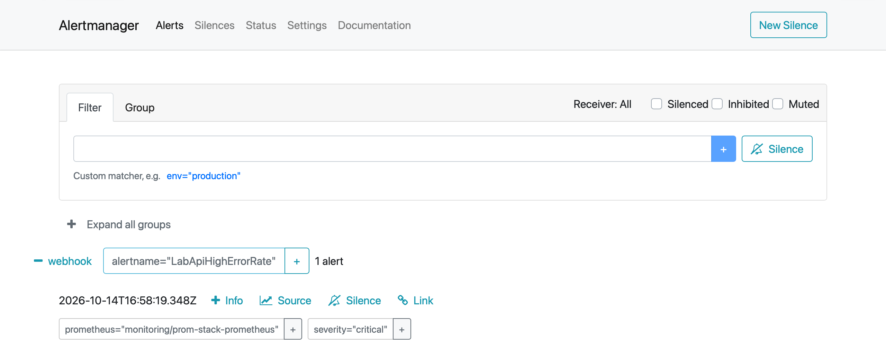

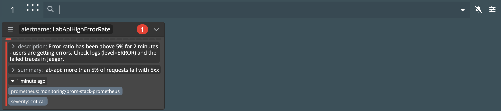

Далее запустим другую команду, которая будет симулировать медленно отвечающий api (`while true; do curl -s "localhost:8080/load?n=50&path=/slow" >/dev/null; done`).

Снова увидим алерт, но теперь `LabApiHighLatencyP95` (95-й процентиль > 1 сек., т.е. как минимум 5% запросов были очень медленно обработаны):

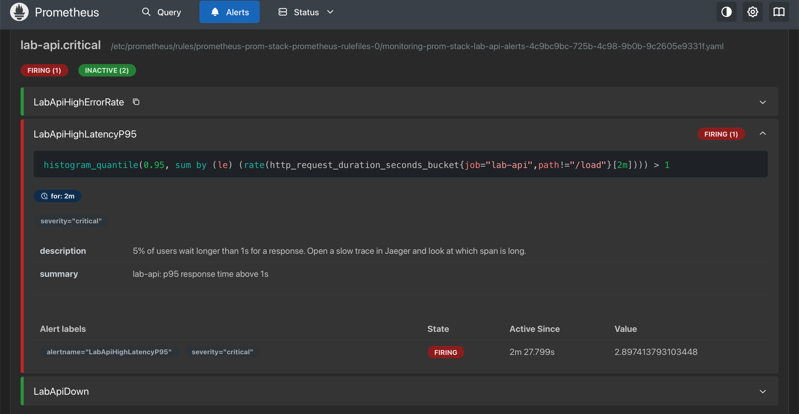

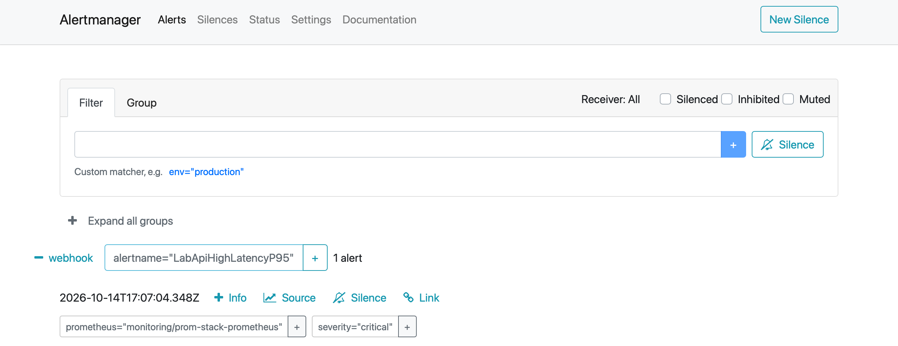

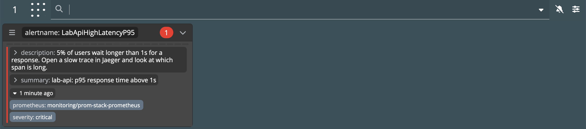

Наконец, запустим команду, ограничивающую количество подов с api до нуля (`kubectl -n lab scale deploy/lab-api --replicas=0`):

Увидим последний алерт — `LabApiDown` (api не отвечает минуту):

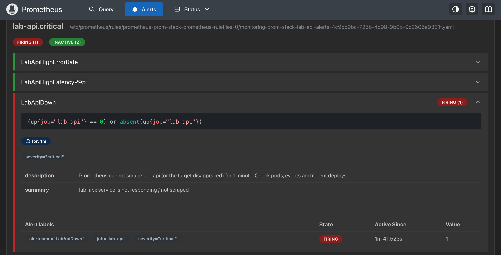

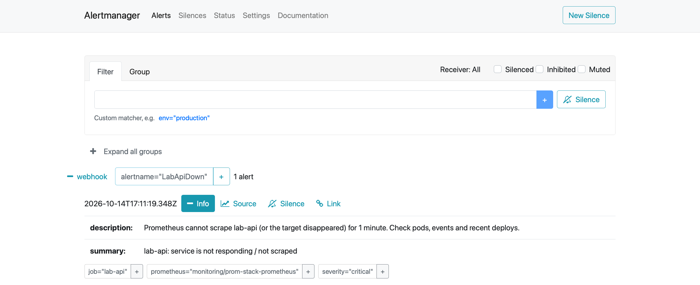

Остановка кластера происходит через команду `docker stop lab-control-plane`, удаление — `kind delete cluster --name lab`.
